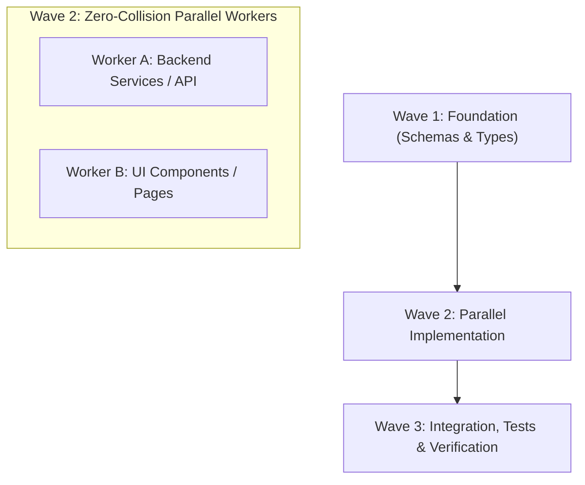

# Parallel Wave Dispatch Protocol

When implementing complex features that involve multiple layers (e.g. database schema, backend API endpoints, and frontend components), serial execution is slow, but uncoordinated parallelism leads to write collisions.

This skill structures development into **ordered, non-conflicting waves**.

## Wave Execution Model



### Wave 1: The Contract Foundation
- **Owner**: Single worker or parent agent.
- **Scope**: Database migrations, Drizzle/Prisma models, shared TypeScript schemas (Zod).
- **Deliverable**: Verified types and exportable interfaces.
- **Rule**: Must compile with `npx tsc --noEmit` before launching Wave 2.

### Wave 2: Concurrent Implementation (Disjoint File Trees)
Launch multiple subagents simultaneously via `invoke_subagent`, ensuring **strict file boundaries**:
- **Worker A (Backend)**: Assigned to `src/server/`, `src/api/`. Forbidden from editing `src/components/`.
- **Worker B (Frontend)**: Assigned to `src/components/`, `src/app/`. Consumes types established in Wave 1.
- **Coordinator Guard**: The coordinator retains sole ownership of `package.json`, root configs, and lockfiles.

### Wave 3: Integration, Quality Gates & Evidence
- Parent agent integrates outputs.
- Execute the full verification suite:
  ```bash
  agy-vibe verify
  ```
- All automated checks must pass before handoff.
