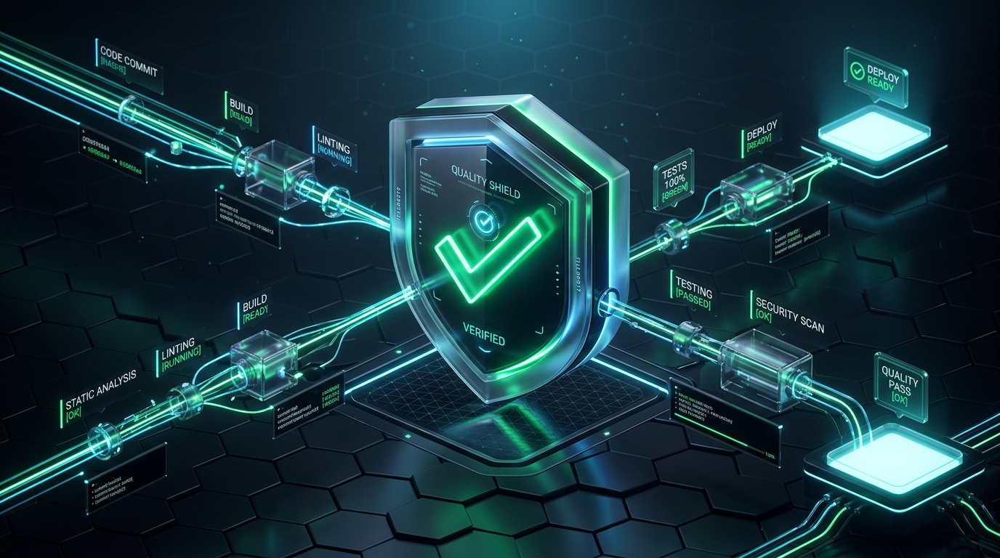
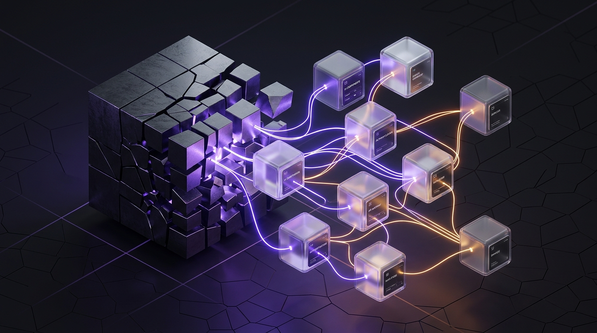
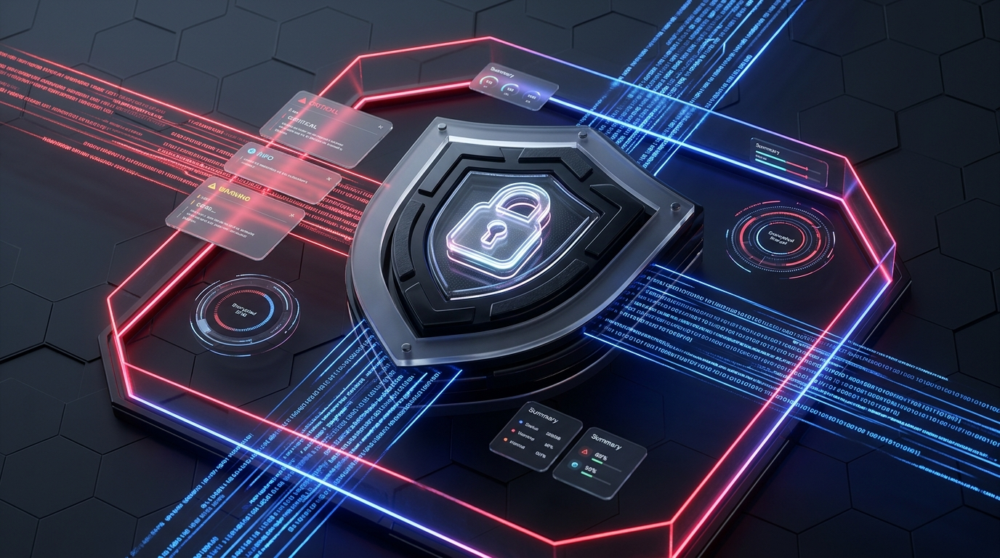
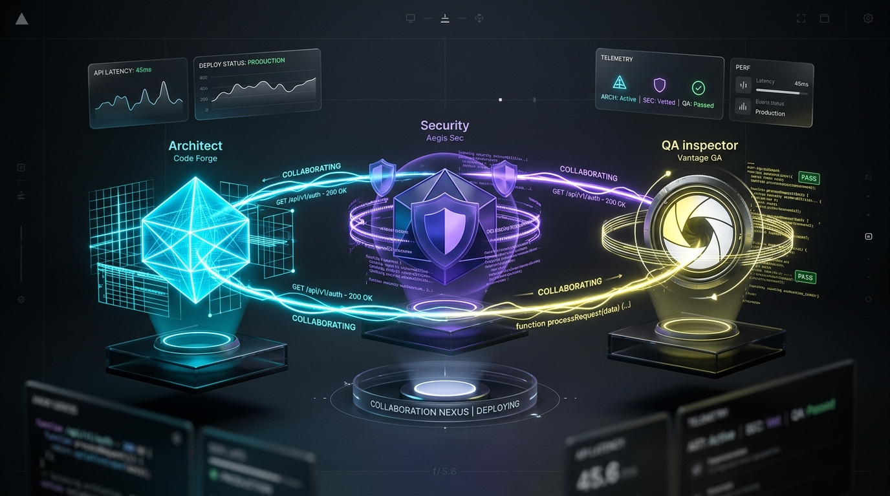
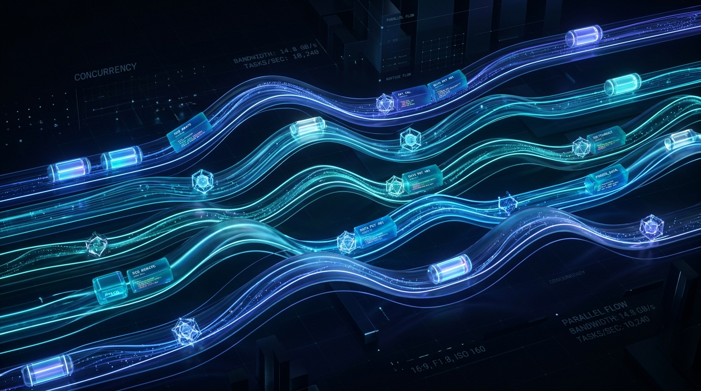
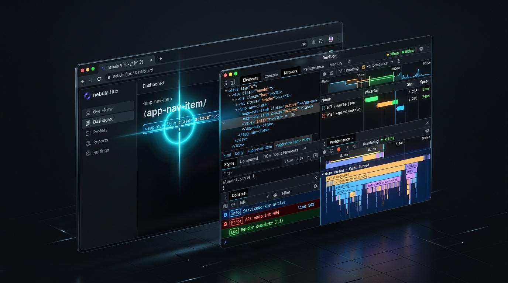
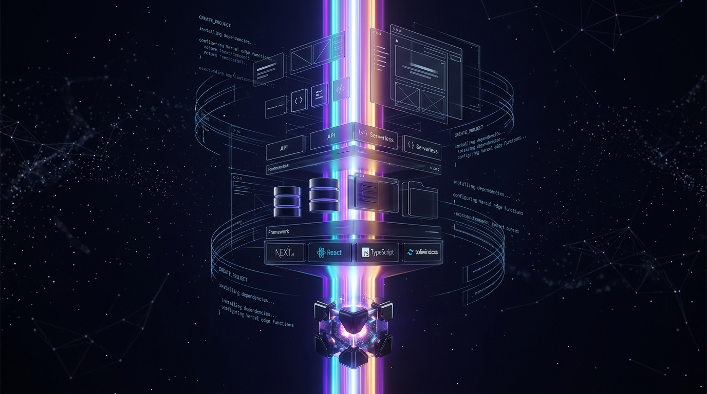

<p align="center">
  
</p>

# Antigravity Vibe Toolkit 🚀

[Português (Brasil)](README.pt-BR.md) · **English**

[](LICENSE)
[](https://deepmind.google)
[](docs/03-subagent-orchestration.md)
[](docs/02-evidence-first.md)
[](docker-compose.yml)

**The definitive autonomous software engineering harness, subagent orchestration engine, quality gate pipeline, and token economy monitor for Google Antigravity.**

Inspired by and building upon [Matheus Gomes' vibe-coding-toolkit](https://github.com/soumatheusgomes/vibe-coding-toolkit), this repository is a **specialized, production-grade edition tailored for the Google Antigravity (DeepMind) ecosystem**. It combines:
* **8 Native Antigravity Skills with Dedicated Visual Badges (`SKILL.md`)** and progressive on-demand disclosure.
* **Evidence-First Quality Pipeline**: Never accept "looks good" without terminal proof of types, lint, tests, and builds.
* **Parallel Wave Subagent Orchestration** with collision-free file-write locking.
* **Antigravity Vibe Monitor (Web Dashboard & Docker)**: Visual local control panel tracking token economy, multi-project compliance, and Obsidian-style persistent memory.
* **Zero-Dependency CLI (`agy-vibe`)** for macOS and Linux developer automation.

---

## ⚡ Installation & Quickstart

<p align="center">
  
</p>

### 1. One-Click Global Installation (Mac / Linux)
Open your terminal in the cloned repository folder and run:
```bash
./scripts/install-global.sh
```

#### What happens behind the scenes?
1. **Registers the `agy-vibe` CLI**: Symlinks the tool into `~/.local/bin/agy-vibe` (or `/usr/local/bin/agy-vibe`), making it immediately accessible anywhere in your shell.
2. **Registers Skills into Antigravity**: Recursively copies all 8 skills into Antigravity's internal directory at `~/.gemini/antigravity/builtin/skills/`.
3. **Instant Activation**: Antigravity automatically discovers and exposes the skills across all your current and future coding sessions without requiring a restart!

### 2. Scaffold Antigravity Foundations in Any Project
Navigate to the root of any new or existing project and run:
```bash
agy-vibe init .
```
This generates the canonical foundation:
* `PRODUCT.md`: Problem statement, MVP scope, and acceptance criteria.
* `AGENTS.md` & `GEMINI.md`: Agent behavior rules and build commands.
* `docs/`: Architecture boundaries, quality standards, and setup manuals.
* `.agents/rules/`: Rules for Evidence-First verification, 350-line file limits, and subagents.

### 3. Verify Quality Gates (Evidence-First)
```bash
agy-vibe verify
```
Automatically executes TypeScript/Python syntax checking, linters, the 350-line file scan, automated test suites, and production builds, generating a Markdown Evidence Report.

---

## 🖥️ Antigravity Vibe Monitor (Web Dashboard & Docker)

A comprehensive local visual control panel running on port `4242` that tracks real-time token savings, multi-project compliance health, and your persistent Markdown memory vault.

### 3 Ways to Launch the Monitor:

1. **Desktop App Icon (Mac)**:
   Double-click the **`Antigravity Monitor.app`** created on your Desktop. It automatically starts the server in the background and opens your default browser!
2. **Via Terminal**:
   ```bash
   agy-vibe dashboard
   ```
3. **Via Docker / Docker Compose**:
   ```bash
   docker compose up -d
   # Open http://localhost:4242
   ```

### What the Dashboard Displays:
* 📊 **Token Economy & Cost Savings**: Real-time calculation of tokens conserved via 350-line modular code boundaries and cached context.
* 📁 **Multi-Project Monitor**: Scans your local repositories, calculating compliance scores (0 to 8) and identifying oversized files.
* 🧠 **Obsidian-Style Memory Vault**: Integrated visual viewer for persistent architectural decisions (`PRODUCT.md`, `architecture.md`, `quality.md`).
* ⚡ **Interactive Skills Showcase**: Illustrated cards detailing YAML frontmatter and triggers for all 8 skills.
* 🛡️ **Live Quality Gate Console**: Interactive button to trigger `agy-vibe verify` and stream verification telemetry in real time.

---

## 🛡️ What is `agy-vibe verify` (Quality Gates)? Do I have to run it?

### Do I need to run this manually?
**No, you are never required to run it manually!** You have two convenient workflows:

1. **Fully Automated via Antigravity**: In your conversation, simply instruct the agent:
   > *"Implement this feature and verify everything with the Quality Gates before finishing."*
   Antigravity will automatically activate the `evidence-first` skill, run `agy-vibe verify` in a background terminal, and present the verified test results directly in its reply.
2. **Manual Execution (Whenever You Want)**: If you prefer to check your repository before pushing code to GitHub:
   ```bash
   cd /path/to/your/project
   agy-vibe verify
   ```

### The 5 Quality Gate Protection Barriers:
1. **Modular Ceiling (<= 350 lines)**: Scans all source files to ensure no file exceeds 350 lines (large files drastically increase AI hallucination and subtle bugs).
2. **Type Safety (Typecheck)**: Executes `npx tsc --noEmit` (TypeScript) or Python compiler to verify zero broken imports or invalid parameter signatures.
3. **Code Quality Linter**: Executes `npm run lint` to enforce clean styling and purge dead/unused variables.
4. **Automated Test Suite**: Executes `npm test` or `pytest` to guarantee that new changes introduce zero regressions to existing code.
5. **Production Build**: Executes `npm run build` to simulate real-world production packaging and catch bundling issues.

---

## 🔬 How the Google Antigravity Skills System Actually Works

<p align="center">
  
</p>

Unlike basic AI coding assistants that dump massive static prompts into the conversation, **Google Antigravity** employs an intelligent progressive discovery model:

### 1. Progressive Disclosure (Zero Context Bloat)
At the start of every turn, Antigravity **does NOT inject the full text of skills** into the model's context window. Instead, it injects only the lightweight YAML frontmatter (`name` and `description` — approximately 30 tokens per skill).
* **Massive Token Savings**: Over 90% of the context window remains strictly dedicated to your codebase and the model's analytical reasoning.
* **On-Demand Activation**: The agent only reads and executes the complete `SKILL.md` when the active task matches that skill's description (e.g. *"Perform a security audit"* dynamically pulls `security-auditor`).

### 2. Resolution & Precedence Order
Antigravity discovers and resolves conflicting skills hierarchically:
1. **`.agents/skills/` (Workspace Project)**: Highest priority. Allows an individual repository to override a global skill with project-specific rules.
2. **`skills.json`**: Explicitly declared workspace registrations.
3. **`~/.gemini/antigravity/builtin/skills/` (Global Machine-Local)**: Where our installer registers skills for machine-wide access.
4. **Builtin System Skills**: Mounted by name by the agent engine.

---

## 🧠 Visual Gallery of the 8 Native Skills

Read the [Detailed Skills Deep Dive with Illustrations](docs/07-skills-deep-dive.md).

| Skill Badge | Name & Trigger | Core Action |
| :---: | :--- | :--- |
|  | **Evidence-First**<br>`evidence-first`<br>*(Concluding any task)* | **The Quality Guarantee**: Runs the verification pipeline in the background and attaches terminal proof of success to the final answer. |
|  | **350-Line Refactorer**<br>`modular-350-refactor`<br>*(Files > 350 lines)* | **The Clean Code Architect**: Splits monolithic files into focused submodules using the Facade pattern without breaking any existing imports. |
|  | **Security Auditor**<br>`security-auditor`<br>*(Security reviews & PRs)* | **The Privacy & SecOps Inspector**: Read-only audit scanning for leaked API keys, `.env` files, SQL injection, and vulnerable dependencies (`npm audit`). |
|  | **Multi-Agent Review**<br>`subagent-review`<br>*(Deep code review)* | **The Review Board**: Spawns 3 specialized subagents simultaneously (Architect, Security, QA) via `invoke_subagent` and synthesizes findings. |
|  | **Parallel Waves**<br>`parallel-waves`<br>*(Large features)* | **The Construction Manager**: Structures work into sequential, collision-free waves (Wave 1: DB & Schemas $\rightarrow$ Wave 2: Backend + UI in parallel $\rightarrow$ Wave 3: Tests). |
|  | **Context7 Docs**<br>`context7-docs`<br>*(Library & API questions)* | **The Up-to-Date Researcher**: Queries current official documentation matching the exact installed package version, preventing deprecated code. |
|  | **Chrome DevTools**<br>`chrome-devtools`<br>*(Frontend & Web UI)* | **The Interface Tester**: Launches Chrome via MCP, inspects browser console errors (hydration mismatches), and tests failing network requests. |
|  | **Project Bootstrap**<br>`project-bootstrap`<br>*(Starting from scratch)* | **The Instant Scaffolder**: Generates a production-ready Next.js / TypeScript or Python project from a 2-line prompt with full governance. |

---

## 🛠️ The `agy-vibe` CLI Reference

The [`bin/agy-vibe`](bin/agy-vibe) tool is written in pure Node.js with zero external dependencies:

```bash
# Scaffold the Antigravity base in the current directory
agy-vibe init .

# Run the Quality Gate verification pipeline and output evidence
agy-vibe verify

# Scan all project files and flag those exceeding 350 lines
agy-vibe sanitize

# Start the local visual Monitor Dashboard & Obsidian Memory Vault on :4242
agy-vibe dashboard

# Reinstall or update global Antigravity skills (~/.gemini/antigravity/...)
agy-vibe install-skills

# Check project compliance score against Antigravity standards
agy-vibe status
```

---

## 🤝 Credits & Attribution

Created by **Daniel Junior Barbosa da Silva** as a dedicated evolutionary edition for **Google Antigravity**, built upon and deeply inspired by the foundational work of [Matheus Gomes (vibe-coding-toolkit)](https://github.com/soumatheusgomes/vibe-coding-toolkit).

We express our sincere appreciation to Matheus Gomes for curating the initial Vibe Coding methodologies. This edition expands those principles to leverage Google DeepMind Antigravity's native subagents, hierarchical rules, and progressive skill disclosure.

---

## 📄 License

Licensed under the [MIT License](LICENSE).
