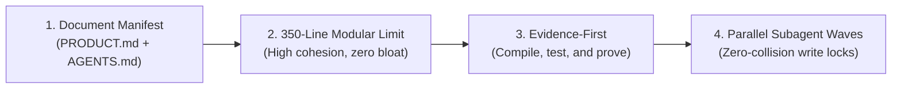

# Antigravity Vibe Toolkit 🚀

[Português (Brasil)](README.pt-BR.md) · **English**

[](LICENSE)
[](https://deepmind.google)
[](docs/03-subagent-orchestration.md)
[](docs/02-evidence-first.md)

**The definitive autonomous software engineering harness and quality gate toolkit for Google Antigravity.**

Inspired by and building upon [Matheus Gomes' vibe-coding-toolkit](https://github.com/soumatheusgomes/vibe-coding-toolkit), this toolkit has been **re-engineered and expanded specifically for Google DeepMind's Antigravity platform**. It provides an integrated suite of **Evidence-First quality gates, parallel wave subagent orchestration, native Antigravity skills (`SKILL.md`), and a zero-dependency CLI (`agy-vibe`)** to elevate agentic coding from speculative prototypes to bulletproof production software.

---

## ⚡ Quickstart

### 1. Global Installation (Mac / Linux)
In your terminal, navigate to the toolkit directory and execute:
```bash
./scripts/install-global.sh
```
This automatically:
1. Links the `agy-vibe` command to your path.
2. Copies all skills into `~/.gemini/antigravity/builtin/skills/`, making them **instantly active in Google Antigravity across your entire machine**.

### 2. Scaffold a Project with Antigravity Foundations
Inside any new or existing project:
```bash
agy-vibe init .
```
This generates the canonical manifest:
* `PRODUCT.md`: Problem scope, MVP definition, and acceptance criteria.
* `AGENTS.md` & `GEMINI.md`: Agent rules and canonical commands.
* `docs/`: Architecture, quality guidelines, and setup runbooks.
* `.agents/rules/`: Rules for Evidence-First verification, 350-line ceilings, and subagents.

### 3. Verify Quality Gates with Proof
```bash
agy-vibe verify
```
Runs typecheckers, linters, file-size scans, automated tests, and production compilation, producing a Markdown-formatted Evidence Report.

---

## 🎯 Architecture & Pillars

Google Antigravity is a premier agentic development environment featuring massive context windows, persistent terminal management, native subagent execution (`invoke_subagent`), and progressive skill discovery.

This toolkit supercharges Antigravity with four core engineering pillars:



---

## 🧠 Native Antigravity Skills (`skills/`)

Each folder contains a standardized Antigravity `SKILL.md` with progressive YAML frontmatter disclosure:

| Skill | Trigger / When to Use | Action |
| :--- | :--- | :--- |
| **`evidence-first`** | Concluding any task or feature | Executes typecheck, lint, test, and build before declaring complete. |
| **`modular-350-refactor`** | Source files exceeding 350 lines | Decomposes code using the Facade pattern without breaking existing imports. |
| **`security-auditor`** | Security reviews and PRs | Audits secret leaks (`.env`), injection flaws, and input boundaries. |
| **`subagent-review`** | Comprehensive code review | Concurrently dispatches 3 subagents (Architect, Security, QA) via `invoke_subagent`. |
| **`parallel-waves`** | Multi-layered features | Orchestrates ordered waves (Database -> Backend & UI in parallel -> Tests). |
| **`context7-docs`** | API and library queries | Retrieves verified, current documentation to eliminate hallucinated syntax. |
| **`chrome-devtools`** | Frontend and UI validation | Audits browser console errors, hydration issues, and network telemetry via MCP. |
| **`project-bootstrap`** | New project from scratch | Scaffolds a complete Next.js / TypeScript / Python stack from a 2-line prompt. |

---

## 🛠️ The `agy-vibe` CLI

The [`bin/agy-vibe`](./bin/agy-vibe) utility is written in pure Node.js with zero external dependencies:

* `agy-vibe init [dir]` — Scaffolds document manifest and workspace rules.
* `agy-vibe verify` — Runs the full verification pipeline and produces terminal evidence.
* `agy-vibe sanitize` — Flags all source files exceeding 350 lines.
* `agy-vibe install-skills` — Registers skills globally in `~/.gemini/antigravity/builtin/skills/`.
* `agy-vibe status` — Checks project compliance against Antigravity standards.

---

## 📁 Repository Structure

```text
antigravity-vibe-toolkit/
├── bin/
│   └── agy-vibe              # Executable CLI tool
├── rules/                    # Canonical Antigravity rules
│   ├── 01-evidence-first.md
│   ├── 02-file-size-limits.md
│   ├── 03-document-manifest.md
│   └── 04-subagent-coordination.md
├── skills/                   # Antigravity skills catalog (SKILL.md)
│   ├── evidence-first/
│   ├── modular-350-refactor/
│   ├── security-auditor/
│   ├── subagent-review/
│   ├── parallel-waves/
│   ├── context7-docs/
│   ├── chrome-devtools/
│   └── project-bootstrap/
├── templates/                # Scaffolding templates
│   ├── product.md.template
│   ├── AGENTS.md.template
│   ├── GEMINI.md.template
│   ├── project-docs/         # architecture.md, quality.md, setup.md...
│   └── mcp/                  # MCP server configuration templates
├── docs/                     # Architectural guides and deep dives
├── scripts/                  # Shell runners and installation scripts
├── LICENSE                   # MIT License
└── README.md
```

---

## 🤝 Credits & Attribution

Created by **Daniel Junior Barbosa da Silva**, based on and inspired by the foundational work of [Matheus Gomes (vibe-coding-toolkit)](https://github.com/soumatheusgomes/vibe-coding-toolkit), to whom we express our full gratitude for pioneering these Vibe Coding patterns.

The **Antigravity Vibe Toolkit** expands and tailors these methodologies specifically for the native subagent engine, workspace rules, and progressive skill loading of **Google Antigravity**.

---

## 📄 License

Licensed under the [MIT License](LICENSE).
