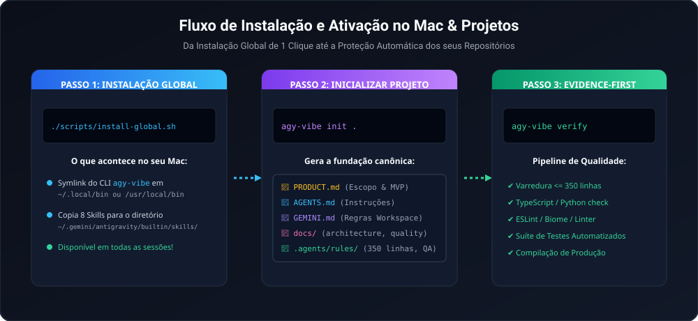
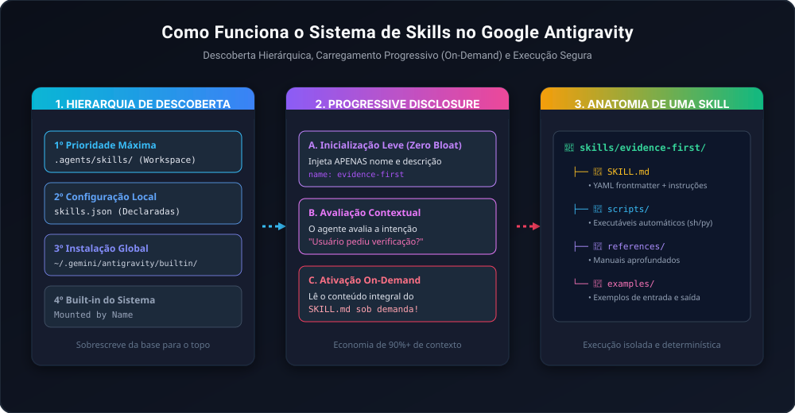

<p align="center">
  
</p>

# Antigravity Vibe Toolkit 🚀

[English](README.md) · **Português (Brasil)**

[](LICENSE)
[](https://deepmind.google)
[](docs/03-subagent-orchestration.md)
[](docs/02-evidence-first.md)

**A esteira definitiva de engenharia de software autônoma, orquestração de subagentes e quality gates para o Google Antigravity.**

Inspirado e construído a partir da curadoria original do [vibe-coding-toolkit de Matheus Gomes](https://github.com/soumatheusgomes/vibe-coding-toolkit), este projeto é uma **edição especializada e expandida para o ecossistema do Google Antigravity (Google DeepMind)**. Ele reúne:
* **8 Skills Nativas (`SKILL.md`)** com descoberta progressiva (*Progressive Disclosure*).
* **Esteira Evidence-First**: Nunca aceite "parece pronto" sem prova de compilação, tipos, lint e testes.
* **Orquestração de Subagentes em Ondas Paralelas** com bloqueio de concorrência por arquivo.
* **Utilitário CLI (`agy-vibe`)** de zero dependências para automação e validação no Mac/Linux.

---

## ⚡ Instalação e Início Rápido

<p align="center">
  
</p>

### 1. Instalação Global de 1 Clique (Mac / Linux)
Abra o seu terminal na pasta do repositório clonado e execute:
```bash
./scripts/install-global.sh
```

#### O que esse instalador faz por baixo dos panos?
1. **Registra o CLI `agy-vibe`**: Cria um symlink em `~/.local/bin/agy-vibe` (ou `/usr/local/bin/agy-vibe`), tornando o comando acessível em qualquer terminal do seu computador.
2. **Instala as Skills no Antigravity**: Copia todas as 8 skills para o diretório interno do Antigravity em `~/.gemini/antigravity/builtin/skills/`.
3. **Ativação Imediata**: O Google Antigravity reconhece as skills automaticamente em todas as suas sessões e projetos, sem precisar reiniciar o sistema!

### 2. Inicializar a Base em Qualquer Projeto
Entre na raiz de qualquer projeto novo ou existente e rode:
```bash
agy-vibe init .
```
Isso gera a fundação canônica:
* `PRODUCT.md`: Escopo, MVP e critérios de aceite.
* `AGENTS.md` e `GEMINI.md`: Regras de conduta do agente.
* `docs/`: Arquitetura, qualidade, setup e onboarding.
* `.agents/rules/`: Regras de Evidence-First, teto de 350 linhas e subagentes.

### 3. Rodar a Esteira de Qualidade (Evidence-First)
```bash
agy-vibe verify
```
Testa tipos, lint, limite de 350 linhas por arquivo, suites de teste e compilação de produção, gerando um relatório em Markdown com prova de execução!

---

## 🛡️ O que é o `agy-vibe verify` (Quality Gates)? Eu preciso rodar isso?

### Eu preciso rodar isso manualmente?
**Não, você não é obrigado a rodar manualmente!** Você tem duas opções:

1. **Totalmente Automático pelo Antigravity**: No chat, você só precisa dizer:
   > *"Implemente essa tela e verifique se está tudo pronto com os Quality Gates."*
   O próprio Antigravity aciona a skill `evidence-first`, roda o comando `agy-vibe verify` em segundo plano e já te responde com o relatório comprovando que tudo passou.
2. **Manual no seu Terminal (quando quiser)**: Se você mesmo quiser conferir seu projeto antes de subir para o GitHub:
   ```bash
   cd /seu/projeto
   agy-vibe verify
   ```

### As 5 Barreiras de Proteção do Quality Gate:
1. **Teto Modular (<= 350 linhas)**: Garante que nenhum arquivo de código ficou gigante demais (arquivos grandes aumentam as chances de a IA alucinar).
2. **Verificação de Tipos (Typecheck)**: Roda `npx tsc --noEmit` (TypeScript) ou compilador Python para garantir zero erros de tipos ou imports quebrados.
3. **Linter de Código**: Roda `npm run lint` para garantir código limpo, sem variáveis não utilizadas ou código morto.
4. **Testes Automatizados**: Roda a suíte de testes (`npm test` ou `pytest`) provando que nenhuma funcionalidade antiga foi quebrada.
5. **Compilação de Produção (Build)**: Roda `npm run build` para garantir que o projeto compilará sem erros nos servidores de produção.

---

## 🔬 Como Realmente Funciona o Sistema de Skills no Google Antigravity?

<p align="center">
  
</p>

Diferente de sistemas que apenas colam prompts gigantescos no chat, o **Google Antigravity** possui uma arquitetura de extensão elegante:

### 1. Progressive Disclosure (Carregamento Sob Demanda)
No início de cada conversa, o Antigravity **NÃO injeta o conteúdo completo das skills** na janela de contexto. Ele lê apenas o cabeçalho YAML (`name` e `description` — cerca de 30 tokens por skill).
* **Zero poluição de contexto**: Mais de 90% da janela de contexto fica 100% livre para o seu código e para o raciocínio do modelo.
* **Ativação Dinâmica**: O agente só carrega o arquivo `SKILL.md` integral se a sua tarefa exigir explicitamente aquele procedimento (ex: *"Audite a segurança desse código"* ativa `security-auditor`).

### 2. Hierarquia de Precedência e Resolução
O Antigravity descobre e prioriza as customizações na seguinte ordem:
1. **`.agents/skills/` (Workspace Local)**: Prioridade máxima. Permite que um projeto específico sobrescreva uma skill com regras próprias do repositório.
2. **`skills.json`**: Registros declarados explicitamente no workspace.
3. **`~/.gemini/antigravity/builtin/skills/` (Global da Máquina)**: Onde o nosso instalador registra as skills para funcionarem em todo o seu Mac.
4. **Skills Nativas do Sistema**: Montadas por nome pelo Antigravity.

---

## 🧠 Guia Completo das 8 Skills (Como e Quando Usar)

Mais detalhes no [Guia Aprofundado de Skills](docs/07-skills-deep-dive.md).

| Skill | Nome & Gatilho | O que faz na prática |
| :--- | :--- | :--- |
| **1. Evidence-First** | `evidence-first`<br>*(Ao finalizar qualquer tarefa)* | **O Selo de Garantia**: Roda a esteira de validação em segundo plano e anexa a prova com logs de sucesso na resposta final. |
| **2. Refatorador 350 Linhas** | `modular-350-refactor`<br>*(Arquivos > 350 linhas)* | **O Arquiteto de Código Limpo**: Divide arquivos gigantescos em submódulos coesos usando o Facade Pattern, sem quebrar os imports do projeto. |
| **3. Auditor de Segurança** | `security-auditor`<br>*(Revisões de segurança)* | **O Auditor de Privacidade**: Modo somente-leitura. Varre vazamento de chaves de API, senhas, SQL injection e vulnerabilidades em pacotes (`npm audit`). |
| **4. Revisão Multi-Agente** | `subagent-review`<br>*(Code review profundo)* | **A Banca Examinadora**: Dispara 3 subagentes em paralelo (Arquiteto, Segurança e QA) via `invoke_subagent` e sintetiza um parecer único. |
| **5. Ondas Paralelas** | `parallel-waves`<br>*(Grandes funcionalidades)* | **O Gerente de Obras**: Organiza o desenvolvimento em etapas sem colisão (Onda 1: Banco $\rightarrow$ Onda 2: Backend e UI em paralelo $\rightarrow$ Onda 3: Testes). |
| **6. Context7 Docs** | `context7-docs`<br>*(Dúvidas de bibliotecas)* | **O Pesquisador de APIs**: Consulta a documentação oficial da versão exata instalada no seu projeto, evitando código depreciado ou alucinado. |
| **7. Chrome DevTools** | `chrome-devtools`<br>*(Frontend e Telas)* | **O Testador de Interface**: Abre o site no Chrome via MCP, checa erros de hydration no console e testa chamadas de rede com falha. |
| **8. Project Bootstrap** | `project-bootstrap`<br>*(Novo projeto do zero)* | **O Construtor Instantâneo**: Scaffolda um projeto completo (Next.js/TypeScript/Tailwind ou Python) a partir de 2 linhas de prompt com qualidade garantida. |

---

## 🛠️ Comandos do Utilitário `agy-vibe`

O binário [`bin/agy-vibe`](bin/agy-vibe) é escrito em Node.js puro, sem dependências adicionais:

```bash
# Inicializa a base do Antigravity no projeto atual
agy-vibe init .

# Executa todos os Quality Gates e gera o relatório de evidência
agy-vibe verify

# Varre todos os arquivos do projeto e alerta os que excedem 350 linhas
agy-vibe sanitize

# Reinstala ou atualiza as skills globais no Antigravity (~/.gemini/antigravity/...)
agy-vibe install-skills

# Checa o status e a pontuação de conformidade do projeto
agy-vibe status
```

---

## 🤝 Créditos e Reconhecimento

Este projeto foi concebido e estruturado por **Daniel Junior Barbosa da Silva** como uma evolução dedicada ao **Google Antigravity**, tendo como base fundamental o trabalho pioneiro de [Matheus Gomes (vibe-coding-toolkit)](https://github.com/soumatheusgomes/vibe-coding-toolkit).

Agradecemos imensamente ao Matheus Gomes por curar a metodologia inicial de Vibe Coding. Nossa edição adapta e expande essa base para a arquitetura nativa de subagentes, discovery de regras e progressive disclosure do Google DeepMind Antigravity.

---

## 📄 Licença

Distribuído sob a [Licença MIT](LICENSE).
