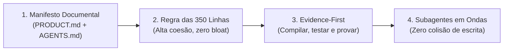

# Antigravity Vibe Toolkit 🚀

[](LICENSE)
[](https://deepmind.google)
[](docs/03-subagent-orchestration.md)
[](docs/02-evidence-first.md)

**A esteira definitiva de engenharia de software e qualidade autônoma para o Google Antigravity.**

Inspirado no trabalho de [Matheus Gomes (vibe-coding-toolkit)](https://github.com/soumatheusgomes/vibe-coding-toolkit), este toolkit foi **re-arquitetado e expandido especificamente para o Google Antigravity (DeepMind)**. Ele traz um conjunto integrado de **regras de qualidade (Quality Gates), orquestração de subagentes em ondas paralelas, catálogo de Skills nativas (`SKILL.md`) e um utilitário de linha de comando (`agy-vibe`)** para transformar qualquer projeto em uma máquina de alta produtividade sem alucinações.

---

## ⚡ Início Rápido (30 Segundos)

### 1. Instalar globalmente no seu Mac / Linux
No terminal, entre na pasta do toolkit e rode o instalador:
```bash
./scripts/install-global.sh
```
Isso faz duas coisas automaticamente:
1. Registra o comando `agy-vibe` no seu terminal.
2. Copia todas as Skills para `~/.gemini/antigravity/builtin/skills/` tornando-as **ativas imediatamente no Google Antigravity**.

### 2. Inicializar um projeto com a base Antigravity
Dentro de qualquer projeto seu:
```bash
agy-vibe init .
```
Isso cria instantaneamente a estrutura canônica:
* `PRODUCT.md`: Escopo, MVP e critérios de aceite.
* `AGENTS.md` e `GEMINI.md`: Regras de conduta do agente.
* `docs/`: Arquitetura, qualidade, setup e onboarding.
* `.agents/rules/`: Regras de Evidence-First, teto de 350 linhas e subagentes.

### 3. Rodar as verificações de qualidade com evidência
```bash
agy-vibe verify
```
Testa tipos, lint, limite de linhas, suites de teste e compilação de produção, gerando um relatório em Markdown com prova de execução!

---

## 🎯 Por que usar este Toolkit no Google Antigravity?

O Google Antigravity é um dos ambientes de programação por agentes mais poderosos do mundo, contando com:
* **Janela de contexto massiva** e raciocínio profundo (Gemini 1.5 Pro / Flash).
* **Execução nativa de terminal persistente** e ferramentas de browser.
* **Orquestração nativa de subagentes** (`invoke_subagent`, `manage_subagents`).
* **Descoberta progressiva de Skills** (`SKILL.md`).

Este toolkit aproveita 100% dessas capacidades e adiciona três pilares cruciais:



---

## 🧠 Catálogo de Skills Nativas (`skills/`)

Cada pasta contém um arquivo `SKILL.md` padronizado para o Antigravity com carregamento progressivo sob demanda:

| Skill | Gatilho / Quando usar | O que faz |
| :--- | :--- | :--- |
| **`evidence-first`** | Ao finalizar qualquer tarefa | Roda typecheck, lint, testes e build antes de dar o trabalho por pronto. |
| **`modular-350-refactor`** | Arquivos longos (>350 linhas) | Decompõe o código usando o padrão Facade sem quebrar imports existentes. |
| **`security-auditor`** | Revisão de segurança | Varre vazamento de secrets (`.env`), injeções e valida fronteiras de dados. |
| **`subagent-review`** | Code review complexo | Dispara 3 subagentes paralelos (Arquiteto, Segurança e QA) via `invoke_subagent`. |
| **`parallel-waves`** | Novas funcionalidades | Organiza o desenvolvimento em ondas (Banco -> Backend + UI em paralelo -> Testes). |
| **`context7-docs`** | Consulta de documentação | Busca APIs atualizadas de bibliotecas para eliminar código legado alucinado. |
| **`chrome-devtools`** | Frontend e UI | Inspeciona erros de console, rede e layout no navegador via MCP. |
| **`project-bootstrap`** | Novo projeto do zero | Cria um projeto Next.js/TypeScript/Python completo a partir de 2 linhas de prompt. |

---

## 🛠️ O Utilitário `agy-vibe` (CLI)

O executável [`bin/agy-vibe`](./bin/agy-vibe) não possui dependências externas (roda diretamente no Node.js):

* `agy-vibe init [dir]` — Cria a estrutura documental e de regras no projeto.
* `agy-vibe verify` — Executa a esteira de validação (tipos, lint, testes, build, linhas) e emite relatório.
* `agy-vibe sanitize` — Identifica todos os arquivos com mais de 350 linhas com contagem exata.
* `agy-vibe install-skills` — Instala as Skills globalmente no Antigravity (`~/.gemini/antigravity/builtin/skills/`).
* `agy-vibe status` — Analisa o nível de conformidade do projeto atual.

---

## 📁 Estrutura do Repositório

```text
antigravity-vibe-toolkit/
├── bin/
│   └── agy-vibe              # CLI executável de automação e quality gates
├── rules/                    # Regras canônicas para o Antigravity
│   ├── 01-evidence-first.md
│   ├── 02-file-size-limits.md
│   ├── 03-document-manifest.md
│   └── 04-subagent-coordination.md
├── skills/                   # Catálogo de Skills com SKILL.md
│   ├── evidence-first/
│   ├── modular-350-refactor/
│   ├── security-auditor/
│   ├── subagent-review/
│   ├── parallel-waves/
│   ├── context7-docs/
│   ├── chrome-devtools/
│   └── project-bootstrap/
├── templates/                # Templates para novos projetos
│   ├── product.md.template
│   ├── AGENTS.md.template
│   ├── GEMINI.md.template
│   ├── project-docs/         # architecture.md, quality.md, setup.md...
│   └── mcp/                  # Configurações de servidores MCP
├── docs/                     # Documentação aprofundada da arquitetura
├── scripts/                  # Scripts de instalação e runners
├── LICENSE                   # Licença MIT
└── README.md
```

---

## 🤝 Créditos e Reconhecimento

Este projeto foi desenvolvido por **Daniel Junior Barbosa da Silva** tendo como base e inspiração central o [vibe-coding-toolkit](https://github.com/soumatheusgomes/vibe-coding-toolkit) de **Matheus Gomes**, a quem prestamos todo o reconhecimento pela curadoria inicial dos padrões de Vibe Coding.

A edição **Antigravity Vibe Toolkit** estende esses conceitos para a arquitetura nativa de subagentes, regras hierárquicas e progressive disclosure do **Google Antigravity**.

---

## 📄 Licença

Distribuído sob a Licença MIT. Consulte [LICENSE](LICENSE) para mais detalhes.
