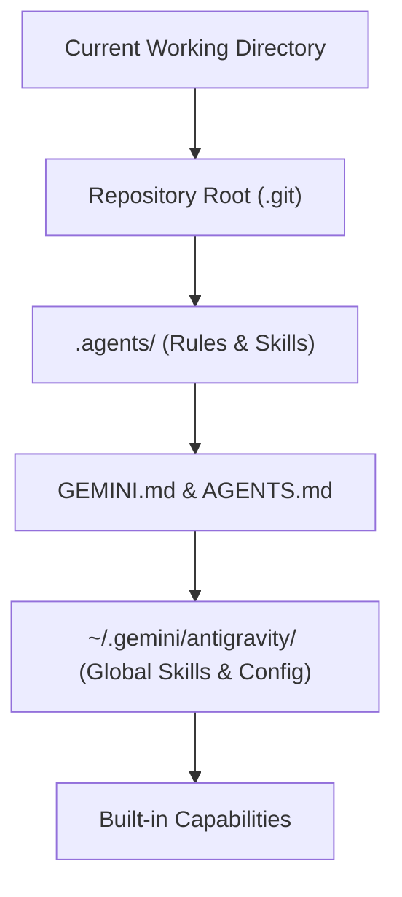

# Google Antigravity Architecture & Customization

This guide explains how **Google Antigravity** processes, discovers, and applies customizations, rules, and skills.

## The Antigravity Discovery Hierarchy

Antigravity uses a hierarchical discovery mechanism to load contextual instructions:

### 1. Workspace Rules (`GEMINI.md` / `AGENTS.md`)
- Walked up from the active file's directory to the repository root.
- Deduplicated automatically by file path.
- Always active within their folder scope.

### 2. Workspace Skills (`.agents/skills/<name>/SKILL.md`)
- Progressive disclosure: only `name` and `description` are loaded initially into context.
- When Antigravity determines a task matches the skill's description, the full runbook is read on demand.
- Prevents token bloat while providing encyclopedic capability.

### 3. Global Skills (`~/.gemini/antigravity/builtin/skills/`)
- Installed machine-wide.
- Accessible in any workspace across the user's computer.
