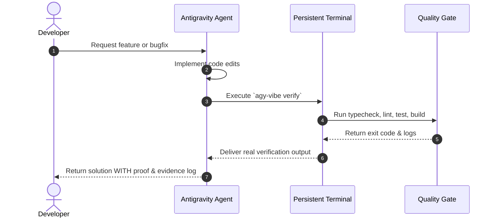

# Evidence-First Methodology: Beyond "Looks Good To Me"

In conventional AI-assisted development, agents often complete code generation and conclude with: *"I have implemented the feature"*. In complex production systems, unverified code frequently contains:
- Subtle type incompatibilities.
- Missing edge-case handlers.
- Uncaught runtime exceptions.
- Broken build scripts.

## The Evidence-First Philosophy

### Verification Criteria

| Level | Check | Command | Pass Criteria |
|---|---|---|---|
| **L1: Modularity** | 350-line file ceiling | `agy-vibe sanitize` | Zero files > 350 lines |
| **L2: Type Safety** | TypeScript / Python types | `npx tsc --noEmit` | Exit code 0, zero type errors |
| **L3: Style & Lints** | ESLint / Biome / Ruff | `npm run lint` | Clean lint report |
| **L4: Regressions** | Automated test suite | `npm test` / `pytest` | All test assertions pass |
| **L5: Production** | Compilation bundle | `npm run build` | Valid production output |
