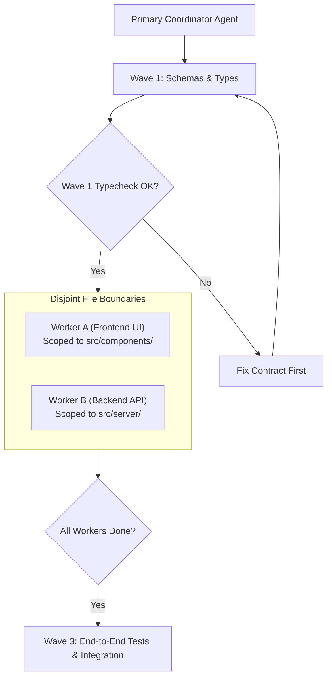

# Subagent Orchestration & Parallel Waves

Google Antigravity features a native subagent execution engine (`invoke_subagent`, `manage_subagents`, `send_message`) with automatic reactive wakeup. This allows distributed multi-agent operations without manual polling.

## Orchestration Patterns

### Pattern A: Multi-Perspective Independent Review
Spawn three specialized review agents simultaneously:
- **Architecture Reviewer**: Audits dependencies, module size (<350 lines), and boundaries.
- **Security Reviewer**: Audits trust boundaries, auth checks, and injection vectors.
- **QA Reviewer**: Tests nullability, asynchronous race conditions, and edge cases.

All reviewers operate **read-only**, reporting their findings back to the coordinator.

### Pattern B: Parallel Implementation Waves
When implementing multi-tiered features:

### Safety Rules for Subagent Dispatch
1. **Never overlap write ownership**: Two subagents must never modify the same file during the same wave.
2. **Coordinator owns global state**: Lockfiles (`package-lock.json`), root configurations, and git commits belong exclusively to the parent agent.
3. **Model selection**: Inherit the parent model by default (`"Model": "inherit"`).
