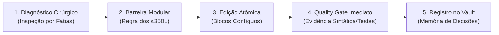

# Metodologia de Edição Cirúrgica para Google Antigravity (ASEM)
## Antigravity Surgical Editing Methodology

> **Propósito**: Estabelecer um protocolo formal, previsível e econômico para que o assistente de IA edite e refatore código com máxima precisão, zero regressões e mínimo consumo de tokens.

---

## 1. Por que uma Metodologia Específica para IA?

As abordagens tradicionais de edição por IA costumam falhar por 3 vícios comuns:
1. **Reescrita Total de Arquivos**: O agente reescreve 500 linhas para alterar 5, apagando comentários, docstrings e introduzindo alucinações silenciosas.
2. **Edição no Escuro**: Tentar editar arquivos sem antes inspecionar o bloco de código e suas dependências.
3. **Inchaço Descontrolado**: Adicionar funcionalidades dentro de arquivos já saturados, tornando a manutenção impraticável.

A **Metodologia Cirúrgica do Antigravity** resolve isso através de **5 fases estritas**:



---

## 2. As 5 Fases da Metodologia

### Fase 1: Diagnóstico Cirúrgico (Targeted Inspection)
* **Regra**: Nunca edite uma linha sem inspecionar a fatia exata de código primeiro.
* **Técnica**: Use `view_file` especificando `StartLine` e `EndLine` para carregar apenas o contexto relevante (ex: 40 linhas em vez de 1.000).
* **Mapeamento de Contrato**:
  - Quais parâmetros a função recebe?
  - Quais tipos ou exceções ela retorna?
  - Quem no projeto depende desse contrato público?

---

### Fase 2: Barreira Modular (The 350-Line Guardrail)
* **Regra de Ouro**: Se o arquivo alvo tem **> 350 linhas** ou a alteração vai fazê-lo ultrapassar esse teto, **NÃO adicione código diretamente nele**.
* **Ação Corretiva**:
  1. Extraia a nova regra de negócio para um módulo irmão dedicado (ex: `services/`, `helpers/`, `utils/`).
  2. Mantenha o arquivo original como uma **Fachada (Facade)** limpa que apenas delega para o novo módulo.
  3. Isso mantém os arquivos pequenos, rápidos de ler e baratos para o cache do Gemini.

---

### Fase 3: Edição Atômica em Bloco Contíguo (Atomic Surgical Diff)
* **Ferramenta Obrigatória**: `replace_file_content`.
* **Proibição**: Nunca use `write_to_file` com `Overwrite: true` em arquivos existentes, exceto para criar arquivos novos do zero.
* **Integridade do Código**:
  - **Zero Ghost Changes**: Mantenha todos os comentários, docstrings e formatações existentes não relacionados à tarefa.
  - **Preservação de Assinaturas**: Nunca altere a assinatura de uma função pública sem atualizar todos os seus pontos de chamada.

---

### Fase 4: Quality Gate Imediato (Closed Feedback Loop)
* **Regra**: Nenhuma edição é dada como concluída sem execução de comando no terminal provando o sucesso.
* **Sequência de Verificação**:
  1. **Sintaxe Imediata**:
     - JavaScript/Node: `node -c <arquivo>`
     - Python: `python3 -m py_compile <arquivo>`
     - TypeScript: `npx tsc --noEmit`
  2. **Testes Unitários / Regressão**:
     - Rodar a suíte de testes do módulo alterado.
  3. **Conformidade de Linhas**:
     - `agy-vibe sanitize` ou contagem de linhas para garantir que continua ≤ 350 linhas.

---

### Fase 5: Memória de Decisões (Obsidian Vault Tracking)
* Para alterações arquiteturais ou de lógica central:
  - Crie uma nota breve em `.agents/decisions/YYYY-MM-DD-nome-da-decisao.md`.
  - Explique o *Problema*, a *Alternativa Escolhida* e os *Módulos Afetados*.
  - O monitor indexa essas decisões automaticamente na aba **Memória Vault** do dashboard (`http://localhost:4242`).

---

## 3. Matriz de Decisão: O que Fazer vs O que Evitar

| Situação | ❌ Abordagem Amadora (Anti-Pattern) | ✅ Metodologia Cirúrgica Antigravity |
| :--- | :--- | :--- |
| **Arquivo com 600 linhas** | Continuar acrescentando funções no final do arquivo. | Extrair responsabilidades em módulos de ≤ 350 linhas (Facade Pattern). |
| **Pequeno ajuste de bug** | Reescrever o arquivo inteiro com `write_to_file`. | Localizar a linha exata e aplicar `replace_file_content` contíguo. |
| **Preservação de contexto** | Apagar comentários e docstrings que parecem "verbosos". | Preservar integralmente comentários e contexto prévio. |
| **Finalização da tarefa** | Dizer *"Pronto, código atualizado!"* sem rodar nada. | Rodar `node -c` ou testes e exibir o output de sucesso comprovado. |
| **Uso de modelos** | Rodar tarefas triviais no modelo mais caro. | Usar `Gemini Flash` para varreduras/testes e reservar `Pro` para arquitetura. |

---

## 4. Como Ativar no seu Projeto

A metodologia já está automatizada pelo **Antigravity Vibe Toolkit**:
1. Para validar a modularidade:
   ```bash
   agy-vibe sanitize
   ```
2. Para rodar todo o Quality Gate:
   ```bash
   agy-vibe verify
   ```
3. Para acompanhar o progresso lado a lado no editor:
   ```bash
   agy-vibe dock
   ```
