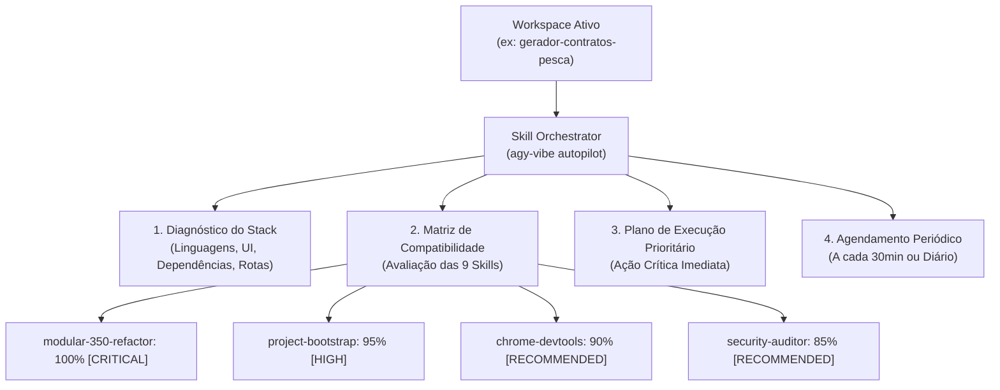

# Guia do Skill Orchestrator & Auto-Pilot (Antigravity)
## Orquestração Inteligente de Skills & Agendamento Periódico

> **Princípio**: Eliminar a adivinhação manual. O sistema inspeciona o projeto ativo, cruza as necessidades reais com todas as skills cadastradas na máquina, executa as mais eficientes e agenda auditorias automáticas periódicas.

---

## 1. O que é o Skill Orchestrator?

O **Skill Orchestrator** é a 9ª skill nativa do *Antigravity Vibe Toolkit*. Ele atua como um maestro inteligente dentro do ecossistema do Google Antigravity:



---

## 2. Matriz de Compatibilidade Automática

Ao rodar no projeto, o orquestrador calcula a pontuação de compatibilidade de cada skill:

| Skill | Gatilho Detectado no Código | Ação Executada |
| :--- | :--- | :--- |
| **`modular-350-refactor`** | Arquivos de código > 350 linhas | Desmembra classes e scripts monolíticos usando o padrão Facade. |
| **`security-auditor`** | Variáveis `.env`, rotas públicas, DB queries | Audita injeções, vazamentos de credenciais e permissões. |
| **`evidence-first`** | Código em desenvolvimento ou testes | Executa Quality Gate completo com provas terminais irrefutáveis. |
| **`project-bootstrap`** | Ausência de `PRODUCT.md` ou `AGENTS.md` | Inicializa a documentação de governança e arquitetura. |
| **`chrome-devtools`** | Presença de interface Web (`.html`, CSS, UI) | Inspeciona responsividade, logs de console e eventos de rede. |
| **`context7-docs`** | Dependências externas sem documentação | Carrega as especificações mais recentes e oficiais das APIs. |
| **`parallel-waves`** | 2 ou mais frentes independentes de refatoração | Divide o trabalho em subagentes paralelos sem colisões de git. |
| **`subagent-review`** | Releases críticas ou revisão de arquitetura | Aciona três subagentes (Arquiteto, Segurança, QA) para validar. |
| **`skill-orchestrator`** | Sempre ativo como maestro | Supervisiona o ciclo de vida e mantém o agendamento em dia. |

---

## 3. Formas de Execução

### A) Via Linha de Comando (CLI One-Liner)
Para analisar qualquer projeto instantaneamente e ver quais skills são compatíveis:
```bash
agy-vibe autopilot
```
Ou apontando para qualquer diretório:
```bash
agy-vibe autopilot "/caminho/do/projeto"
```

---

### B) Como Macro no Google Antigravity (`@` ou Slash Command)
No chat do Antigravity, você pode invocar o orquestrador de 3 formas:
1. **Pelo Arroba (`@`)**:
   - Digite `@autopilot` ou `@skill-orchestrator`.
2. **Por Comando de Voz / Texto Natural**:
   - *"Analise o projeto e rode as skills compatíveis."*
   - *"Qual skill devo usar neste projeto agora?"*
3. **Pela Regra do Agente**:
   - O arquivo [`.agents/rules/06-skill-orchestrator.md`](file:///Users/danieljuniorbarbosadasilva/Desktop/antigravity-vibe-toolkit/.agents/rules/06-skill-orchestrator.md) instrui o agente a rodar a matriz de compatibilidade automaticamente.

---

### C) Agendamento Periódico Automático (Background Cron & Sidecars)

Para manter verificações recorrentes gravadas (ex: a cada 30 minutos ou uma vez por dia), utilize o agendador integrado:

#### 1. Agendamento a cada 30 minutos:
```bash
agy-vibe schedule 30m
```
*Gera uma automação nativa do Antigravity em `~/.gemini/config/sidecars/vibe-autopilot/sidecar.json` com o cron `*/30 * * * *`.*

#### 2. Agendamento Diário (às 09:00):
```bash
agy-vibe schedule daily
```

#### 3. Agendamento Durante a Sessão Ativa:
Você também pode pedir no chat do Antigravity:
> *"Agende para rodar o autopilot daqui a 30 minutos e verificar se algum arquivo novo passou de 350 linhas."*
*(O Antigravity usará a ferramenta nativa `schedule` para acordar e auditar no momento exato).*

---

## 4. Onde Ver os Resultados

1. **No Terminal:** Relatório colorido com barras de compatibilidade e ação prioritária.
2. **No Dashboard (`http://localhost:4242`):**
   - Na aba **Skills (9)** com a nova ilustração do Orquestrador Mestre.
   - Na aba **Memória Vault** para leitura das regras de auditoria.
3. **No Companion Side-by-Side:** No painel lateral dentro do próprio Antigravity.
